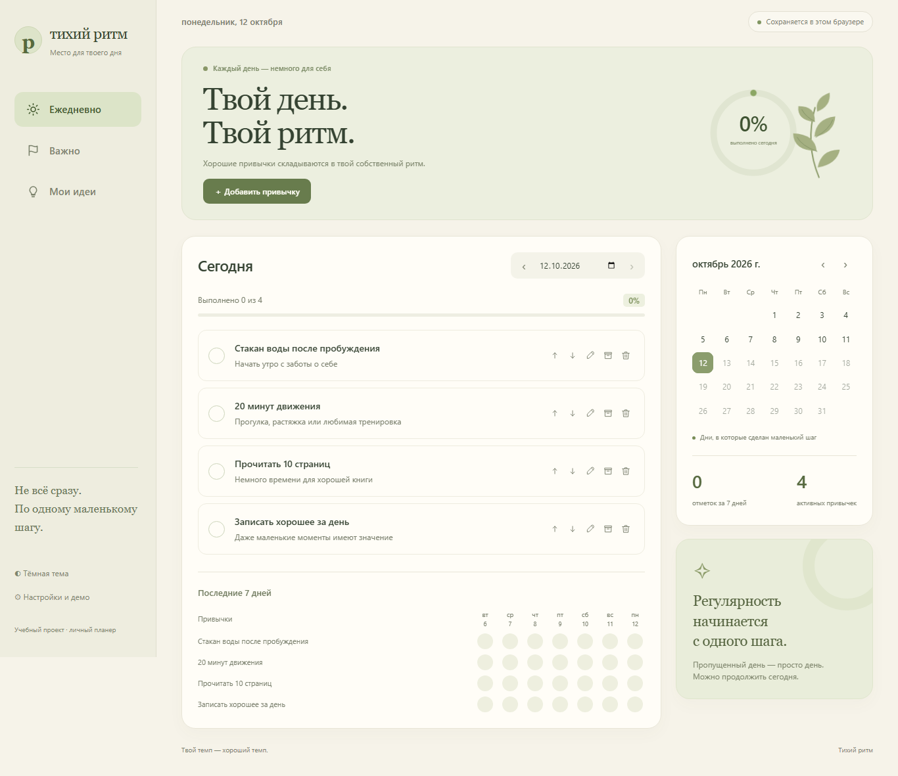
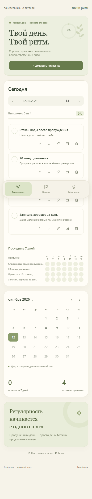

# Тихий ритм

Учебный проект по вайб-кодингу, созданный с помощью Codex: адаптивный личный планер с привычками, задачами и идеями.

## Возможности

- Привычки: галочки, зачёркивание, расписание по дням недели, история, календарь, интерактивная недельная сетка, архив и изменение порядка.
- Задачи: доска со статусами «Нужно сделать», «В работе», «Выполнено»; сроки, три цветных приоритета и закрепление.
- Идеи: быстрые заметки, поиск, редактирование, закрепление и создание задач из идей.
- Настоящий голосовой ввод на русском через Web Speech API, редактирование текста перед сохранением.
- Светлая и тёмная темы, демонстрационные данные и их сброс.
- Сохранение в localStorage без регистрации и платных сервисов.

## Технологии

HTML, CSS, JavaScript. Нет сборки, сторонних библиотек или внешних шрифтов. Для публикации достаточно файлов проекта.

## Запуск

Откройте папку проекта через любой локальный HTTP-сервер (например, расширение Live Server). Для микрофона используйте localhost или опубликованный сайт с HTTPS.

## Бесплатная публикация на GitHub Pages

1. Создайте публичный репозиторий в GitHub, например `quiet-rhythm`.
2. Загрузите **содержимое** этой папки: `index.html`, `style.css`, `modern.css`, `garden.css`, `cozy.css`, `app.js`, `favicon.svg`, `.nojekyll`, `README.md`, `screenshots`.
3. Откройте **Settings → Pages**.
4. В **Build and deployment** выберите **Deploy from a branch**.
5. Выберите ветку **main**, папку **/(root)** и нажмите **Save**.
6. После публикации ссылка появится на странице Pages. Добавьте её в описание репозитория и отправьте вместе со ссылкой на код преподавателю.

Все пути к ресурсам относительные, поэтому приложение поддерживает размещение в подпапке репозитория.

## Ограничения

Данные хранятся только в текущем браузере. Синхронизации между устройствами нет; очистка данных сайта удаляет записи. Проект не сохраняет аудио и не расшифровывает загруженные аудиофайлы.

Голосовой ввод зависит от поддержки Web Speech API и доступности сервиса распознавания браузера. Может требовать интернет и передачу речи сервису браузера. При недоступности остаётся ручной ввод. Реальное распознавание с микрофоном нужно проверить на опубликованном сайте; автоматические проверки интерфейса не подтверждают качество распознавания речи.

## Скриншоты

### Ноутбук — 1366 px

### Телефон — 390 px

В папке `screenshots` также есть варианты 768, 1024, 1920 и 2560 px.

## Проверка перед сдачей

- Откройте публичную ссылку и обновите страницу.
- Отметьте привычку, добавьте задачу и сохраните идею; обновите страницу и проверьте сохранение.
- В поддерживаемом браузере разрешите микрофон, надиктуйте фразу на русском, остановите ввод и сохраните текст.
- Перед демонстрацией можно восстановить примеры в настройках через «Сбросить демо».

Исходный код: [MIT](LICENSE).

## Оформление

Уютный цифровой планер: молочный фон, шалфейные, пудрово-персиковые и лавандовые разделы, кольцо прогресса и пастельные карточки идей. Деликатные анимации учитывают настройку уменьшения движения.
